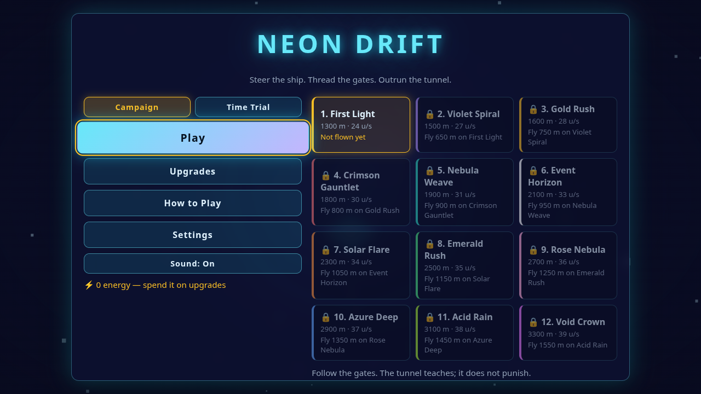
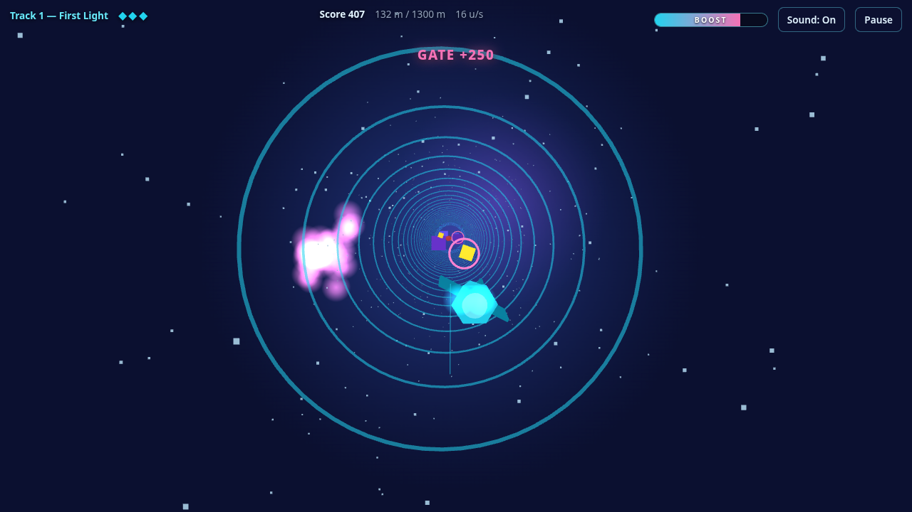

# Neon Drift

A 3D neon tunnel racer — **steer your ship through a glowing tunnel at
rising speed**. Dodge violet blocks and mines, time your pass through
moving barrier walls, thread magenta boost gates for speed and score,
and collect gold energy cells. You have 3 shields: a hit costs one and
stuns the ship; lose all three and the run ends. Reach the end of the
track to complete it. Score comes from distance, gates and cells — your
best distance is saved per track.

**Live:** https://namdev-muse.github.io/neon-drift/
**Version:** v0.3.0 (M3 feel & juice)
**Stack:** Three.js 0.160.0 (pinned via jsdelivr import map, no build step), vanilla HTML/CSS/JS, Web Audio synth SFX + generative music, GitHub Pages.

## Gameplay

Real captures from a headless-Chromium run of the game
(`npm run screenshots` regenerates them — see `tests/screenshots.js`).

## The core: steering is the skill

The ship flies forward on its own and only gets faster. Steering has
momentum and banking — the ship goes where you point it, but it takes a
moment to get there, so you steer early and commit. There is no
auto-steer, no assist, and nothing that tells you the answer before you
act. Holding the centre line is never free: every stretch of every
track guards the centre with a block, a mine, or a barrier wall. The
bot harness proves it — the greedy steering bot completes all 12 tracks,
while holding centre fails all 12 within the first 700 m.

## Tracks

Twelve hand-crafted tracks, each with its own identity (palette, layout,
obstacle rhythm), built from dense segments — slalom, gate lines, mine
fields with a guaranteed corridor, moving barriers, weaves, gauntlets,
and the spiral: gates that orbit the centre, so the ship must fly a
circle, not a line. No empty straights: every stretch has a decision.
The opening seconds are gentle — the ship starts centred and slow —
then the tunnel tightens. The curve is smooth: the bot's run time grows
steadily from 68 s on track 1 to 91 s on track 12, with no cliff
between adjacent tracks.

| # | Track | Length | Top speed |
|---|-------|--------|-----------|
| 1 | First Light | 1300 m | 24 u/s |
| 2 | Violet Spiral | 1500 m | 27 u/s |
| 3 | Gold Rush | 1600 m | 28 u/s |
| 4 | Crimson Gauntlet | 1800 m | 30 u/s |
| 5 | Nebula Weave | 1900 m | 31 u/s |
| 6 | Event Horizon | 2100 m | 33 u/s |
| 7 | Solar Flare | 2300 m | 34 u/s |
| 8 | Emerald Rush | 2500 m | 35 u/s |
| 9 | Rose Nebula | 2700 m | 36 u/s |
| 10 | Azure Deep | 2900 m | 37 u/s |
| 11 | Acid Rain | 3100 m | 38 u/s |
| 12 | Void Crown | 3300 m | 39 u/s |

## Controls

- Mouse / touch: drag to steer
- Arrow keys / WASD: steer
- Space (or the Boost button on touch): boost — drains the meter, refills passively and through gates
- P: pause · M: mute · R: restart · Esc: back / pause

## Game feel

Every event fires a layered bundle of 5–8 responses within ~100 ms
(sound, particles, shake, flash, knockback, hit-stop, slow-mo, FOV
pulse, floating score pops) — the tiers stay proportional: small
events pop, medium events punch, large events shake the whole screen.
Trauma screen shake with hit-stop, near-miss slow-mo, camera roll with
the bank, speed pull-back, FOV kick with speed plus a pulse on gates
and boost, ship squash on hits, engine glow that breathes with speed.
Web Audio synth SFX (pitch-varied so repeats never machine-gun) and a
generative synthwave sequencer — bass line plus arpeggio that doubles
in density as the ship speeds up. Screen-shake and reduce-flashing
settings; every effect decays back to its exact rest state.

## Tests

- `npm run smoke` — 312 physics checks (tracks, steering, boost, gates, cells, hits, save, feedback tiers + layer bundles, anti-slop gate)
- `npm test` — smoke + bot (steering bot completes all 12 tracks; holding centre fails all 12)
- `npm run render-check` — headless Chromium: menu over the live 3D scene, steering, gates, cells, shield loss, run-over, pause, restart, plus the M3 juice assertions (score pops, music sequencer, FOV pulse, shake toggle, reduce-flashing, exact rest state), zero console errors
- `npm run screenshots` — README captures + 3-resolution size sweep (1280x720, 2560x1080, 1080x2340), inspected by eye

## Devlog

See [docs/devlog.md](docs/devlog.md).
